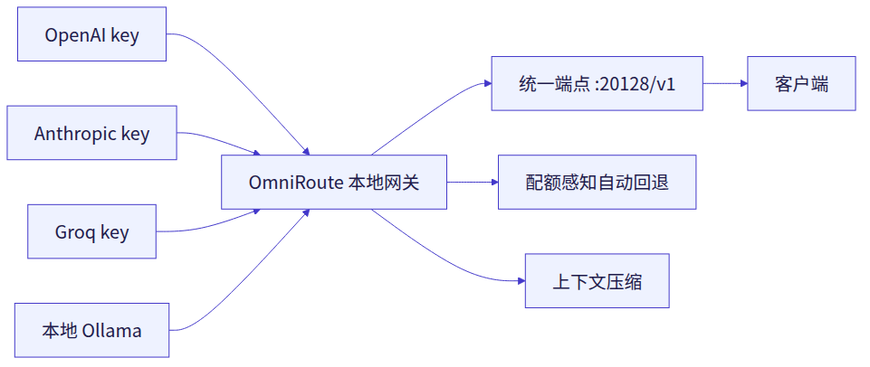
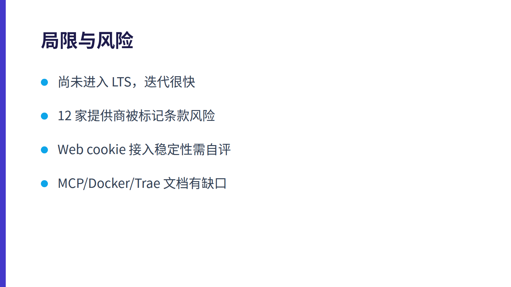

- 来源：GitHub 近期爆火
- 仓库：https://github.com/cheaper-inference/OmniRoute
- Stars：84540
- 语言：TypeScript
- 创建时间：2026-02-13
- 最近更新：2026-11-04
- 官方简介：Never stop coding. Free MIT AI gateway: one endpoint, 375 providers (150+ free), 1,400+ models Kimi, Claude, GPT, Gemini, GLM, DeepSeek, MiniMax. Works with Claude Code, Codex, Cursor, OpenCode, Cline & Copilot. Quota-aware auto-fallback, RTK+Caveman compression saves 15-95% tokens, MCP/A2A, Desktop/PWA. Built by 900+ contributors

---

# OmniRoute 使用说明书

> 一个 MIT 开源的 AI 网关：把 380 家提供商（其中 150+ 有免费额度）、1400+ 模型收敛到一个 OpenAI 兼容端点 `http://localhost:20128/v1`，配额耗尽或目标不可用时自动切换到下一个健康目标——最适合想用免费额度、又不想在十几个 SDK 和限流之间来回折腾的开发者。

## 它到底解决什么问题

日常写 Java/Spring 时，AI 助手的痛点通常不是「没有模型」，而是**模型散落在十几个平台**：OpenAI 一个 key、Anthropic 一个 key、Groq 一个 key、本地 Ollama 又是另一套地址；每个平台有自己的限流、自己的免费额度、自己的 SDK。一旦某个 key 配额打满，工具就报错停摆。

OmniRoute 的做法是把这些统一成一个本地网关：

- **单一端点**：所有客户端都指向 `http://localhost:20128/v1`，协议是 OpenAI 兼容的。
- **配额感知自动回退**：当某个目标不可用或配额耗尽时，OmniRoute 选择下一个健康目标继续服务。
- **上下文压缩**：一条 12 引擎的流水线可把符合条件的上下文压缩 15–95%，官方给出的工具密集型示例约省 89%（`context 18,400 → 2,024`）。
- **免费额度目录**：官方称目录中收录 484 条免费额度条目、34 个可循环的池键，并按「有公开月度正预算的 17 个池 + 5 个 Groq 单模型上限」去重计算，得出约 **1.62B tokens/月** 的口径；首月含注册赠送额度最高约 2.22B。

> 这个 1.62B 是**第三方免费额度聚合估算**，不是 OmniRoute 发放的 token。官方明确写了「Bring your own provider accounts」：你需要自己注册、自己拿凭证，各提供商的限额与条款由它们自己决定。

<!-- asset:blog-1 start -->


*图：OmniRoute 统一网关示意*
<!-- asset:blog-1 end -->


## 核心概念

| 概念 | 含义 |
| --- | --- |
| Provider（提供商） | 上游 AI 服务，接入方式分 5 类：25 个 OAuth（Claude Code、Codex、Cursor、GitHub Copilot、Kimi Code 等）、233 个 API key（OpenAI、Anthropic、Groq、NVIDIA、Cerebras、Mistral 等）、35 个 Web cookie（ChatGPT Web、Claude Web、Gemini Web、Grok Web）、14 个本地运行时（Ollama、LM Studio、vLLM、llama.cpp）、13 个无鉴权路由（OpenCode Free、Felo、Pollinations 等） |
| 统一端点 | `http://localhost:20128/v1`，OpenAI 兼容 |
| 自动回退 | 目标不可用/配额耗尽时自动切到下一个健康目标 |
| 压缩 | 12 引擎流水线，节省 15–95% token |
| Combos | 官方称为「旗舰」能力，用于组合多个目标 |
| MCP / A2A | 网关同时提供 MCP 与 A2A 接口 |
| 部署形态 | 自托管（`npx omniroute`、Docker、源码/pnpm、Arch 包）或 OmniRoute Cloud 托管 |

版本口径在不同渠道略有差异：官网首页写 **352 家提供商**，仓库版本表写 `v3.8.53+` 为 **380 家提供商、1491 个唯一 chat 模型 ID**；官方简介则写 375 家、1400+ 模型。以你实际安装到的版本为准。

## 环境与前置依赖

- **Node.js 环境**：官方给出的最简启动方式是 `npx omniroute`，因此需要可用的 Node.js/npm 环境。
- **可选 Docker**：官方在 Docker Hub 发布镜像 `diegosouzapw/omniroute`。
- **可选桌面端**：提供 Electron 桌面版与 PWA。
- **提供商账号**：想用免费额度就得自己注册对应平台并取得凭证；无鉴权路由（如 OpenCode Free、Felo、Pollinations）不需要 key 即可快速起步。
- **Java/Spring 侧**：不需要任何特殊依赖——因为它是 OpenAI 兼容的 HTTP 端点，Java 项目用现成的 OpenAI 兼容客户端或直接发 HTTP 请求即可。

## 安装与启动（Windows PowerShell）

### 方式一：npx 直接跑（最快）

1. 打开 PowerShell，执行官方给出的启动命令：

```powershell
npx omniroute
```

2. 看到网关在 `localhost:20128` 运行即表示进程已起。
3. 浏览器打开 `http://localhost:20128` 进入 Dashboard，在 `/dashboard/free-tiers` 可以看到免费额度的实时用量与剩余。

### 方式二：Docker

官方在 Docker Hub 提供 `diegosouzapw/omniroute` 镜像。具体端口映射与挂载参数官方未在给出的资料中展开说明，请以镜像页面为准。

### 方式三：源码 / pnpm

仓库说明中列出了源码与 pnpm 安装路径，但具体命令未在本次资料中给出，官方未公开说明细节。

> **无头模式**：`v3.8.53+` 新增 `serve --headless`，适合只想要端点、不要界面的场景。

<!-- asset:code-1 start -->
```powershell
npx omniroute
```
<!-- asset:code-1 end -->


## 接入 Trae Work 与 Java / Spring 工作流

OmniRoute 的接入本质是**改两个值**：base URL 和 API key。官方对通用客户端的说法是「Replace your base URL and API key. Keep your messages, tools, streaming, and response handling exactly where they are.」

### 在 Trae Work 中作为 OpenAI 兼容端点使用

官方明确列出 35 个受支持集成，包括 Claude Code、Codex、Cursor、Cline、Copilot、Antigravity 等，统一指向 `:20128/v1`。**官方未提供与 Trae Work 的专门集成方式**，因此可行路径是走通用的 OpenAI 兼容配置：在 Trae Work 的模型/自定义提供商设置中，把 Base URL 填为 `http://localhost:20128/v1`，API Key 填你在 OmniRoute Dashboard 中生成的密钥（若使用无鉴权路由则按 Dashboard 提示处理）。

> 由于官方没有 Trae Work 的专门文档，上述字段名以 Trae Work 当前版本的界面为准；如果 Trae Work 只接受特定厂商模板，请选择「OpenAI 兼容 / Custom OpenAI」类模板。

### 在 Java / Spring 项目中调用

OmniRoute 是标准 OpenAI 兼容 HTTP 服务，Java 侧不需要 SDK 适配层。以 Spring 的 `RestClient` 为例，把 base URL 指向本地网关即可（示例为通用写法，非官方示例）：

```java
// 仅示意：base URL 指向 OmniRoute 本地端点
restClient.post()
    .uri("http://localhost:20128/v1/chat/completions")
    .header("Authorization", "Bearer <your-omniroute-key>")
    .body(request)
    .retrieve()
    .body(ChatResponse.class);
```

好处是：你在 Spring 里只维护一个客户端配置，背后换模型、换提供商、配额回退都由网关处理，业务代码不用动。

### 作为 MCP 服务

官方简介写明支持 **MCP/A2A**，但**未公开说明 MCP 服务的具体启动命令、传输方式（stdio/SSE）与配置片段**。若要在 Trae Work 中作为 MCP 服务接入，需要以你安装版本的实际输出为准，暂无公开资料可直接照抄。

## 如何确认安装成功

1. 终端出现网关运行提示，地址为 `localhost:20128`。
2. 浏览器能打开 Dashboard，`/dashboard/free-tiers` 页面能显示免费额度池的实时用量。
3. 在 Trae Work 或任意 OpenAI 兼容客户端里发一条最简单的对话请求，能收到回复即打通。
4. 在 Dashboard 的请求历史里能看到这条请求的记录。

## 免费额度怎么算（以及为什么别全信）

官方的方法论写得很克制，值得单独说：

- 目录收录 **484 条免费额度条目**，对应 **34 个可循环池键**。
- 头条数字只统计 **17 个有公开月度正预算的池 + 5 个 Groq 单模型上限**，并按共享池去重。
- 需要区域身份验证才开放的额度（目前是 ModelScope）单独展示，约 +6M，**不计入头条**。
- 每两周按实时目录重新审计，数字**会涨也会跌**。
- 目录中 **12 家提供商被标记为条款风险、建议规避**。

> 换句话说：1.62B 是「如果你把所有能注册的免费池都注册满」的理论聚合值，不是开箱即得。实际到手取决于你能注册多少家、各家条款是否允许你这样用。

## 局限与风险

| 维度 | 情况 |
| --- | --- |
| 许可证 | MIT，可自由使用与修改 |
| 费用 | 自托管无软件订阅费；OmniRoute Cloud 为按月托管费，推理费用另计 |
| 成熟度 | 仓库创建于 2026-02-13，最近更新 2026-11-04，迭代很快（版本表显示 v3.8.50 → v3.8.53+ 连续演进），Roadmap 指向 `v3.9.0 LTS`，说明尚未进入 LTS |
| 条款风险 | 官方自己标注 12 家提供商存在条款风险；Web cookie 类接入（ChatGPT Web、Claude Web 等）依赖浏览器会话，稳定性与合规性需自行评估 |
| 数据路径 | 自托管时请求经过你本机；使用 Cloud 时请求经过托管方。官方强调自托管「Your keys, subscriptions, and providers」 |
| 数字波动 | 免费额度头条每两周重审，会双向变动 |
| 文档缺口 | MCP 具体配置、Docker 详细参数、Trae Work 专门集成均无公开说明 |

<!-- asset:blog-2 start -->


*图：使用前需注意的风险*
<!-- asset:blog-2 end -->


## 社区评价

本次可核验的公开讨论主要来自官方渠道（Discord、Telegram、WhatsApp 群组）与官网展示的 84.5k stars、Trendshift 上榜记录。**Hacker News 上的具体讨论内容在本次资料中未包含**，因此不对社区口碑做转述。可确认的客观信号是：仓库星标数高、贡献者规模官方称为 900+、npm 与 Docker Hub 均有分发。

## 一句话建议

如果你在 Windows 上用 Trae Work 写 Spring，且手上已经攒了几个免费 API key，OmniRoute 值得花十分钟 `npx omniroute` 跑起来试试——它最大的价值不是「免费」，而是**把配额回退和上下文压缩这两件脏活从你的业务代码里拿走了**。但别把 1.62B 当成承诺，也别在没读条款的情况下把 Web cookie 类接入用于生产。

```text
背景：我在 Windows 上用 Trae Work 开发 Java/Spring 项目，已在本机通过 npx omniroute 启动了 OmniRoute 网关（端点 http://localhost:20128/v1）。

目标：把 OmniRoute 接入我的日常开发流，并验证它在 Spring 项目里的可用性。

具体要求：
1. 帮我把 Trae Work 的模型提供商配置改为 OpenAI 兼容模式，Base URL 指向 http://localhost:20128/v1，并说明 API Key 从哪里获取；如果 Trae Work 不支持自定义 OpenAI 兼容端点，直接告诉我，不要编造配置路径。
2. 生成一个最小可运行的 Spring Boot 示例：用 RestClient 调用 http://localhost:20128/v1/chat/completions，包含请求体、鉴权头和响应解析，能直接放进现有项目。
3. 说明如何在 OmniRoute Dashboard 的 /dashboard/free-tiers 页面查看免费额度用量，以及如何判断某次请求走了哪个提供商。
4. 列出接入时最容易踩的三个坑（例如端口占用、key 未配置、模型名不匹配），每个坑给出排查命令或检查点。
5. 所有命令用 Windows PowerShell 写法；不确定的地方明确标注「官方未公开说明」，不要猜测。
```

---

> 本文由 AI 综合官方仓库、项目官网与第三方公开资料撰写，已要求其仅依据公开资料成文；关键命令请以官方文档为准。
