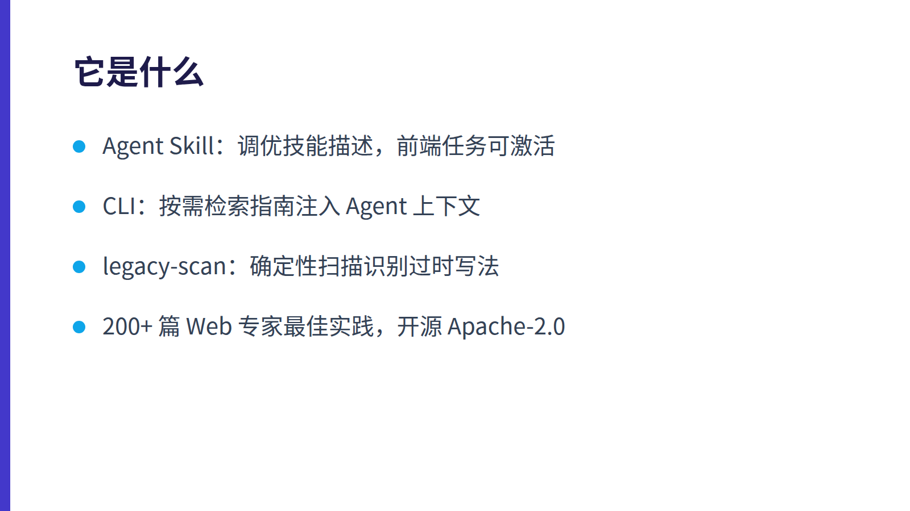
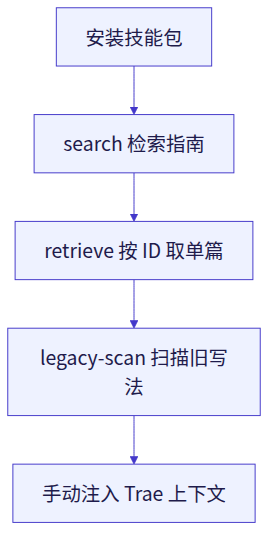

- 来源：Hacker News Show HN
- 项目链接：https://github.com/GoogleChrome/modern-web-guidance
- HN 讨论：https://news.ycombinator.com/item?id=50443812（423 points）

---

> **一句话定位**：Google Chrome 团队联合 Firefox、Edge、MDN 发布的编码 Agent 技能包与 CLI，用 200+ 条现代 Web 平台最佳实践，把 Agent 从「2019 年的 JavaScript 写法」拉回原生 API 时代。**面向做前端/Web 界面的开发者**；纯 Java 后端、不碰浏览器代码的读者可以跳过。

## 它是什么

编码 Agent 的训练数据里堆满了旧代码，所以即使模型「知道」`<dialog>`、`CSS.highlights`、`field-sizing` 这些新 API 存在，也常常默认生成 `<div>` + 几十行 JS 的老套路。Modern Web Guidance 就是针对这个问题的**领域知识补充包**：

- **Agent Skill**：技能描述经过调优，能在相关前端任务上被激活；
- **CLI（Agentic RAG）**：按需检索指南并注入 Agent 上下文，官方称纯 JS 包约 7MB、CPU 上搜索约 10ms；
- **legacy-scan**：基于 3 万个 GitHub 仓库训练的确定性扫描，识别过时写法供 Agent 现代化改造，官方称留出仓库上平均精确率 92%。

内容规模：**200+ 篇**由 Web 专家手工编写的实现最佳实践（约 1.7MB），随 Web 演进更新，开源（Apache-2.0）。仓库已有约 5k star、158 fork。

<!-- asset:blog-1 start -->


*图：Modern Web Guidance 三件套*
<!-- asset:blog-1 end -->


## 为什么值得试

官方给出的评估数据是核心卖点：用 codex / claude / agy 在 200 个任务上跑，**无技能时通过率 55%，加载技能后 92%**，共约 1700 条基于 Playwright/AST 的断言。

它覆盖的方向包括：

| 方向 | 例子 |
| --- | --- |
| 用户体验 | View Transitions、进出场动画、视差滚动、`scrollbar-color` |
| CSS 布局 | 原生布局能力替代 JS 计算 |
| 原生交互 | `<dialog>` + `showModal()` 自带背景遮罩与焦点管理 |
| 文本高亮 | `CSS.highlights` 免去满屏 `<span>` |
| 自适应输入 | `field-sizing` 让 textarea 随输入自动增高 |
| 回退策略 | 引导使用轻量回退，而非重型 polyfill 或旧库 |

## 社区怎么评价

HN 讨论帖 423 分，评论分歧明显：

- **支持方**认为「最佳实践没死」——只要它能带来更好的用户体验；有人明确表示宁愿要 1 行 CSS，也不要 60 行 `ResizeObserver`/`setTimeout` 的样板代码，并指出前端最佳实践不只是代码，还包括键盘可导航性、布局不抖动等质量底线。
- **质疑方**认为 AI 时代没人会读 AI 产出的代码，「最佳实践」意义存疑；也有人担心 Agent 不断堆出上千行代码、侵蚀可维护性，把可维护性称为「下一个前沿」。
- 还有评论直接批评帖子文本「AI 味太重」，或质疑这是不是在变相卖 token/算力。

整体看：**工具本身口碑正面，争议集中在「AI 生成代码还要不要人读」这个更大的话题上**，与工具质量关系不大。

## 怎么开始试用

官方提供交互式安装向导（命令前加 `DISABLE_TELEMETRY=1` 可关闭遥测）：

1. 安装：`DISABLE_TELEMETRY=1 npx modern-web-guidance@latest install`
2. 不安装也能先试检索：`DISABLE_TELEMETRY=1 npx modern-web-guidance@latest search "animate dialog modal"`
3. 按 ID 取单篇指南：`npx modern-web-guidance@latest retrieve "animate-to-from-top-layer"`
4. 扫描旧写法：`DISABLE_TELEMETRY=1 npx modern-web-guidance@latest legacy-scan ./src`

仓库内已提供面向 Claude、Codex、Cursor、Gemini、Grok、Kimi 等的插件/扩展配置目录，说明它按各家 Agent 的插件机制分别适配；**Trae Work 的原生接入方式官方未公开说明**，暂无公开资料，建议先用 CLI 检索 + 手动注入上下文的方式验证效果。

<!-- asset:code-1 start -->
```powershell
DISABLE_TELEMETRY=1 npx modern-web-guidance@latest install
DISABLE_TELEMETRY=1 npx modern-web-guidance@latest search "animate dialog modal"
npx modern-web-guidance@latest retrieve "animate-to-from-top-layer"
DISABLE_TELEMETRY=1 npx modern-web-guidance@latest legacy-scan ./src
```
<!-- asset:code-1 end -->


<!-- asset:blog-2 start -->


*图：四步试用流程*
<!-- asset:blog-2 end -->


## 对 Java 后端 + Trae Work 用户的价值判断

坦白说，**如果你的 Trae Work 工作流主要写 Java / Spring 后端，这个项目基本用不上**——它全部围绕浏览器端 Web 平台能力，与 Spring、JVM、后端架构无关。

但如果你在 Trae Work 里同时维护**管理后台前端、Thymeleaf 模板、内嵌页面或前后端一体的 Web 界面**，它就有实际价值：Agent 生成弹窗、动画、自适应输入框这类 UI 时，更容易直接落到原生 `<dialog>`、`field-sizing` 上，而不是又给你塞一堆 JS 和第三方库。可以先跑一次 `legacy-scan` 看看现有前端代码里有多少可现代化的旧写法，再决定是否常驻。

```text
背景：我在 Windows 上用 Trae Work 做 Java/Spring 后端开发，偶尔维护管理后台的前端页面（HTML/CSS/少量 JS）。我看到了 GoogleChrome/modern-web-guidance 这个项目（Chrome/Firefox/Edge/MDN 联合发布的编码 Agent 技能包 + CLI，含 200+ 条现代 Web 最佳实践，官方称 Agent 通过率从 55% 提升到 92%）。

目标：帮我判断它是否值得纳入我的日常开发流程，并给出可执行的试用方案。

要求：
1. 先说明这个工具的作用范围，明确它对我这种以 Java 后端为主的技术栈是否有实际价值；
2. 给出在 Windows + Trae Work 环境下最小成本的试用步骤（优先用 npx CLI 的 search / retrieve / legacy-scan，注意加 DISABLE_TELEMETRY=1），并说明每一步预期看到什么结果；
3. 挑一个我项目里常见的 UI 场景（例如弹窗、表单自动增高、列表高亮），对比「旧写法」和「现代 Web 原生写法」，说明后者能省多少代码、有哪些兼容性风险；
4. 如果 Trae Work 没有官方原生接入方式，请说明如何手动把检索到的指南注入到我的编码上下文中；
5. 最后给出一句话结论：装还是不装，以及适合在什么场景下启用。
```

---

> 本文由 AI 综合Show HN 原帖与社区讨论撰写，已要求其仅依据公开资料成文；关键命令请以官方文档为准。
