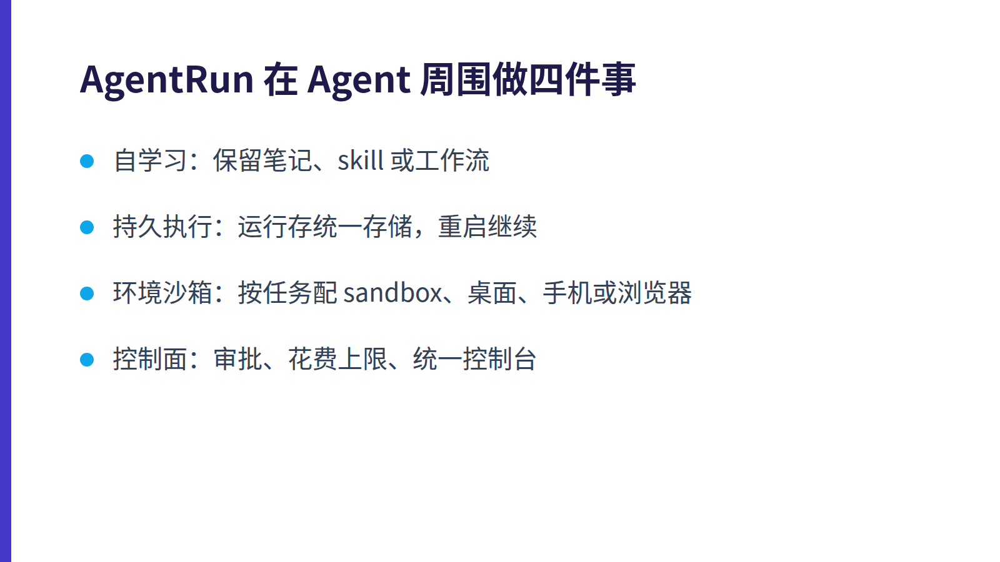
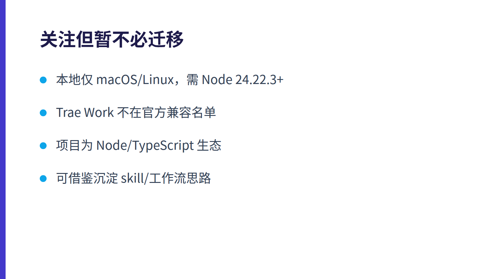

- 来源：Hacker News Show HN
- 项目链接：https://github.com/Parcha-ai/agentrun/blob/main/README.md
- HN 讨论：https://news.ycombinator.com/item?id=50471650（138 points）

---

## 一句话定位

> **AgentRun 是一个开源「托管式 Agent 平台」：在你已有的 Agent Harness（Claude Code、Codex、OpenCode、pi 等支持 ACP 的壳）之上，叠加自学习、持久执行和控制台。适合已经在用编码 Agent、想让它们越跑越省 token 且不丢任务的人。**

---

## 它是什么

AgentRun 由 GREP.AI（YC F26）开源（Apache-2.0），把团队自用的 Agent Harness 外围能力产品化。核心主张是：**Agent 很擅长「摸索」，但会把同一件事反复摸索**——同一个任务跑第一百遍，它还在重读同样的文档、重建同样的计划，每个 token 都要你付钱。

AgentRun 不替换你的 Agent，而是在它周围做四件事：

| 能力 | 说明 |
|---|---|
| **自学习** | 每次运行后保留有用的东西：一条笔记、一个 skill，或一套不再需要循环的工作流；下次从那里起步 |
| **持久执行** | 每次运行存在统一存储里；服务中途被杀，重启后运行继续 |
| **环境沙箱** | 按任务给 Agent 配电脑：sandbox、Linux 桌面、Android 手机或浏览器 |
| **控制面** | 审批、花费上限、统一控制台：谁在等你、谁失败了、在跑什么、花了多少钱 |

另外还带 Web 检索类工作流、大量工具与集成、以及 Agent 行为分析。

**自带 Agent**：官方称兼容 Pi、Claude Agents、Codex、OpenCode，以及任何支持 ACP 的 harness。

<!-- asset:blog-1 start -->


*图：AgentRun 四项核心能力*
<!-- asset:blog-1 end -->


---

## 为什么值得试

官方给出的两个案例（均为其自述数据，未独立验证）：

- **代码评审**：Greptile 涨价后账单从每月 180 美元涨到 6,451 美元；他们用便宜模型自建评审器并在自家 PR 上调优，**每次评审 0.18 美元**，在 30 个没见过的 PR 上抓到的真实 bug 是 Greptile 的 **1.6 倍**。
- **商户分类**：先让 Opus 摸索分类方法，再把学到的交给便宜模型，**单商户成本从 0.89 美元降到 0.12 美元**。

对个人开发者，真正有吸引力的点是「**同一类任务重复跑时，token 账单能降下来**」和「**长任务不怕中断**」。

---

## 社区怎么看

HN 讨论帖 138 points，评论不多，主要围绕两点：

- **UI/UX 被吐槽**：有评论认为 AI 生成的界面设计还得再等几代模型，并批评「只会 prompt『给 dashboard 建个页面』」的做法。
- **官方回应**：承认在托管版和主站上花了很多时间做 UI，但**开源控制台投入很少**，正在改进。
- **同行交流**：有开发者展示自己用 Python 写的自主 Agent（含运行时发现其他 Agent、逐动作安全检查层），表示欣赏 AgentRun 的 mission control，会借鉴；官方回应欢迎互相借鉴。
- **集成诉求**：有人问能否作为数据源接入（其系统有约 200 个政府登记机构集成、5 亿实体），也有人问**有没有 MCP**（官方称正在做内部工具代理，可接入任意 MCP）。

> 结论：**架构和「自学习 + 持久执行」的思路受认可，开源控制台的完成度是当前短板**。

---

## Java 程序员 / Windows + Trae Work 视角

**先说结论：与 AI 辅助软件开发有关，但对你当前工作流的直接增益有限，属于「可以关注、暂不必迁移」的一类。**

- **平台限制**：本地运行要求 **Node 24.22.3+，且仅 macOS 或 Linux**。你在 Windows 上日常用 Trae Work，本地跑不起来，只能走托管版（console.agentrun.ai）或 Docker/Render 自托管。
- **Harness 兼容**：它围绕 Claude Code、Codex、OpenCode、pi 设计，**Trae Work 不在官方列出的兼容名单里**；能否通过 ACP 接入，**官方未公开说明**。
- **语言栈**：项目本身是 Node/TypeScript 生态，与 Java/Spring 无直接关系；它的价值在于「管 Agent」，不在于「帮写 Spring 代码」。
- **可借鉴的点**：即便不装，它「把重复任务的摸索结果沉淀成 skill/工作流」的思路，可以直接搬到你的 Trae Work 工作流里——把常用脚手架、CRUD、单测生成沉淀成固定指令，减少重复 prompt。

<!-- asset:blog-2 start -->


*图：Windows + Trae Work 视角要点*
<!-- asset:blog-2 end -->


---

## 怎么开始试用

**方式一：托管版（Windows 用户最省事）**

1. 打开 `console.agentrun.ai`，注册或登录。
2. 在控制台里配置模型与你的 Agent。

**方式二：本地运行（需 macOS/Linux + Node 24.22.3+）**

1. 执行 `npx @parcha/agentrun`。
2. 服务与一个 runner 起在 7340 端口（被占用则顺延），数据存在 `~/.agentrun`，浏览器自动打开控制台。
3. 在控制台设置密码，然后点 **Continue with ChatGPT** 登录 OpenAI 账号（Codex 与 pi Agent 走你的 ChatGPT 套餐，无需 key）；或在 Settings → Model keys 里填自己的模型 key。

**方式三：自托管**

- 官方提供 Render 一键部署与 Docker 方式，自托管需要一个 OpenRouter key。

**注意**：以上步骤来自项目页，具体界面与字段可能随版本变化；Windows 原生支持情况**暂无公开资料**。

<!-- asset:code-1 start -->
```powershell
npx @parcha/agentrun
```
<!-- asset:code-1 end -->


---

## 快速评估指令（复制给 Trae Work 等助手）

```text
背景：我在 Windows 上用 Trae Work 做 Java/Spring 后端开发，看到开源项目 AgentRun（github.com/Parcha-ai/agentrun），它是一个托管式 Agent 平台，给 Claude Code/Codex/OpenCode/pi 等 harness 叠加自学习、持久执行和控制台，要求 Node 24.22.3+ 且仅支持 macOS/Linux 本地运行。

目标：判断它是否值得我投入时间试用，以及能否融入我的 Trae Work 工作流。

要求：
1. 基于项目页与公开资料，列出它的核心能力与适用场景，明确标注哪些信息官方未公开说明。
2. 评估在 Windows + Trae Work 环境下的可行接入路径（托管版 / Docker 自托管 / ACP 兼容性），指出阻塞点。
3. 对比「直接用 Trae Work 内置能力」与「引入 AgentRun」的收益差，给出是否试用的明确建议。
4. 如果建议试用，给出一份 30 分钟内可完成的最小验证步骤清单（含需要准备的账号与 key）。
5. 不要编造官方未提供的信息，不确定处直接写「暂无公开资料」。
```

---

> 本文由 AI 综合Show HN 原帖与社区讨论撰写，已要求其仅依据公开资料成文；关键命令请以官方文档为准。
