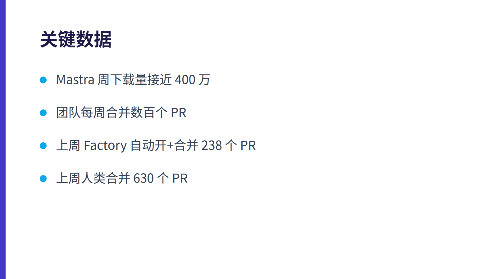

- 来源：Hacker News Show HN
- 项目链接：https://news.ycombinator.com/item?id=50548660
- HN 讨论：https://news.ycombinator.com/item?id=50548660（74 points）

---

# Mastra Factory：可@的智能体看板，一周自动合并238个PR

> 一句话定位：Mastra 团队开源的「软件工厂」——一个可在 Slack 里 @ 的智能体看板，用长时智能体会话自动跑 triage/plan/build/review/shipped 流程；面向维护大型开源仓库的团队，**与 Java/Spring 及 Trae Work 日常开发无直接关系，Java 程序员可跳过**。

## 它是什么

Mastra 团队（Shane、Sam、Abhi）两年前在 HN 发布过 TypeScript 智能体框架 Mastra。这次他们开源的是**自己用来维护 Mastra 本身的内部工具**——Mastra Factory。

作者对「软件工厂」的定义很具体：

> 对我们来说，Factory 就是一个**可配置的智能体看板（agentic kanban board）**，并且可以在 Slack 里 @ 它。

底层能力包括：

- **持久化智能体（durable agents）**：支撑长时间运行的会话；
- **对话式记忆系统**：跨会话保留上下文；
- **基于 markdown 的 wiki**：带来源引用，用于注入公司知识；
- **信号机制**：订阅 PR 评论并接入会话；
- **可定制的云沙箱**：内置其编码 harness，官方称正在支持 Claude Code、Codex 等。

<!-- asset:blog-1 start -->


*图：Factory 的智能体看板流程*
<!-- asset:blog-1 end -->


## 为什么值得关注

官方给出的量化结果：

| 指标 | 数据 |
|---|---|
| Mastra 周下载量 | 接近 400 万 |
| 团队每周合并 PR | 数百个 |
| 上周 Factory 自动开+合并 | 238 个 PR |
| 上周人类合并 | 630 个 PR |

流程模型最初按团队原有工作流设计：**triage → plan → build → review → shipped**。三个月后，团队发现自己**主要通过 Slack 而非 Web UI 驱动它**。

一些实际用法：

- 资深工程师会并行启动多个会话，例如「把最老的 20 个 issue 都 triage 一遍，我们来评估……」；
- 接入 bug 与漏洞扫描器；
- 关闭仓库的外部贡献入口，改为要求提交详细的 issue 复现。

<!-- asset:blog-2 start -->


*图：官方量化数据*
<!-- asset:blog-2 end -->


## 社区怎么评价

HN 讨论（74 points）几乎全部集中在「**关闭外部贡献者 PR**」这一点上，而非产品功能本身：

- 有人问：这种「关仓库、只要 issue」的模式会不会成为开源常态？
- 作者回应：低价值 PR 数量暴涨，同时自己动手做这些改动又变得很容易；并提到 sindresorhus 等维护者有类似理由。
- 有评论认为这未必是坏事：能更正确地处理需求；也有人怀念「有人从 PR 里出现、后来成为团队成员」的偶然性。
- 一条实用建议：用 GitHub Issues 会招来扫描 issue 并自动生成 PR 的机器人；换用其他 issue 追踪器、保持 GitHub issues 为空，可减少大量低质量自动 PR。
- 作者补充：现在连 issue 都有「AI 味」——模型会生成你根本不会排进任何 sprint 的 issue，**下一个前沿是只修真正重要的 issue**。

注意：讨论中**没有**关于安装体验、性能或与其他工具对比的评价。

## 怎么开始试用

官方给出的入口是 `npm create factory`。

1. 在终端执行 `npm create factory`（需 Node/npm 环境）；
2. 项目完全开源，可**完全跑在自己的基础设施上**；官方也提供托管版本；
3. 项目页：`factory.mastra.ai`；代码仓库：`github.com/mastra-ai/template-factory`。

关于系统要求、Windows 支持情况、与 Java 项目的集成方式：**官方未公开说明**。

<!-- asset:code-1 start -->
```powershell
npm create factory
```
<!-- asset:code-1 end -->


## 对 Java 程序员 / Trae Work 用户的判断

- 技术栈是 **TypeScript + Mastra 框架 + Slack + GitHub**，不是 Java/Spring 生态；
- 它解决的是「**维护大型开源仓库的 PR/issue 流水线**」，不是「写业务代码时补全、重构、调试」；
- 因此它**不属于 AI 辅助软件开发的日常工具**，对在 Windows 上用 Trae Work 写 Java 的读者，**建议直接跳过**；
- 唯一可借鉴的是理念：把 triage/plan/build/review 做成可 @ 的智能体会话，以及「只修真正重要的 issue」的取舍。

```text
背景：我是一名 Java 后端程序员，日常在 Windows 上使用 Trae Work（AI IDE）开发，技术栈以 Java/Spring 为主。我看到了 Mastra Factory 这个开源「软件工厂」项目：它是一个可在 Slack 里 @ 的智能体看板，用持久化智能体会话跑 triage/plan/build/review/shipped 流程，底层是 TypeScript 的 Mastra 框架，官方称上周自动开并合并了 238 个 PR。

目标：请帮我评估它对我的日常开发是否有价值，并给出可执行的结论。

要求：
1. 先判断它是否与「AI 辅助 Java 软件开发」相关；若不相关，直接说明我可以跳过，不要强行推荐。
2. 若相关，说明它能否融入我的 Trae Work 工作流，需要哪些前置条件（Node、Slack、GitHub 等）。
3. 指出官方资料中未公开的信息（如 Windows 支持、系统要求、与 Java 项目集成方式），不要编造。
4. 提炼 2-3 个即使不采用该工具、也值得借鉴的工程理念。
5. 输出控制在 300 字以内，用要点列表。
```

---

> 本文由 AI 综合Show HN 原帖与社区讨论撰写，已要求其仅依据公开资料成文；关键命令请以官方文档为准。
