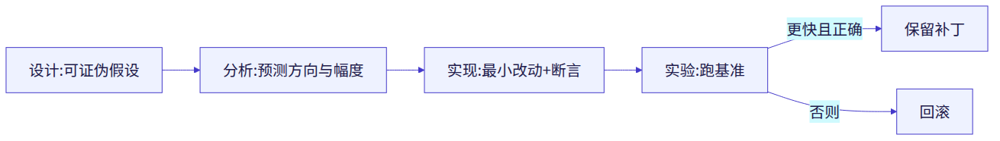
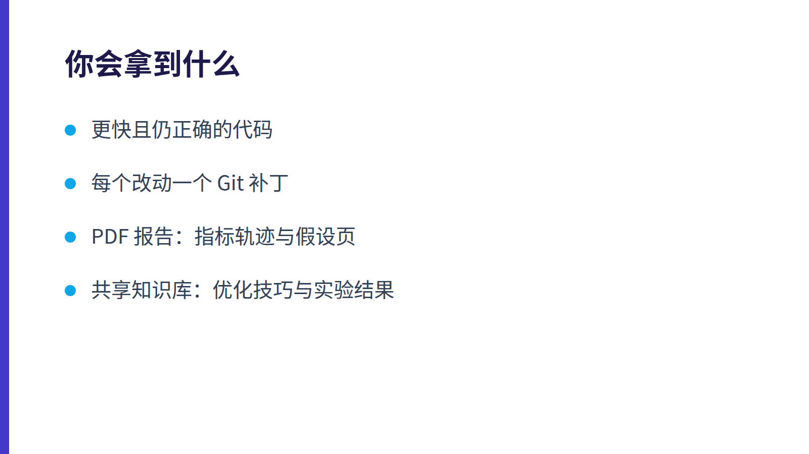

- 来源：Hacker News Show HN
- 项目链接：https://chszlab.github.io/AgenticAlgorithmEngineering/
- HN 讨论：https://news.ycombinator.com/item?id=50611593（66 points）

---

## 一句话定位

> **AAE（Agentic Algorithm Engineering）是一个把「算法工程」的可证伪假设循环交给 AI Agent 自动执行的 Skill，适合需要让现有代码库在保证正确性的前提下持续变快的开发者。**

它来自海德堡大学算法工程组，官方定位是 **Claude Code 与 Codex 的 Skill**。对日常在 Windows 上用 Trae Work 写 Java/Spring 的读者：**它与 AI 辅助软件开发有关，但主要面向「性能优化 + 正确性断言」场景，不是通用编码助手**，是否值得装取决于你是否有可基准测试的性能瓶颈代码。

---

## 它解决什么问题

传统「让 AI 改代码变快」的做法，往往是让 Agent 直接改、看指标、再改，缺少可审查的推理链条。AAE 把算法工程领域的方法论固化成循环：

1. **设计**：先提出可证伪假设，例如「改动 X 会让指标提升约 Z，因为……」
2. **分析**：在测量前先预测效果的方向与幅度（基于 profiling 与分析）。
3. **实现**：做最小改动，提交到 Git，并检查正确性断言。
4. **实验**：跑基准；只有「更快且仍然正确」才保留，否则回滚。

启动时你与 Agent 约定**基准、指标、正确性断言和预算**，之后它自主运行。

<!-- asset:blog-1 start -->


*图：AAE 的四步循环*
<!-- asset:blog-1 end -->


---

## 你会拿到什么

| 产出 | 说明 |
|---|---|
| 更快且仍正确的代码 | 每次改动都对照你约定的断言检查，例如输出逐位一致 |
| 每个被接受改动一个补丁 | `patches/` 下编号 Git 补丁，各自附带假设，便于逐个审查与应用 |
| PDF 报告 | 指标轨迹 + 每个被测假设一页：直觉、预测、测量、结论 |
| 共享知识库 | 汇集优化技巧与实验结果，Agent 开始前会先读；欢迎贡献自己会话的产出 |

官方给出的 KaHIP kaffpa 会话示例：**122 次实验、69 个假设、41 个补丁，整体快 3.9 倍**。

<!-- asset:blog-2 start -->


*图：AAE 的四类产出*
<!-- asset:blog-2 end -->


---

## 官方公布的效果（均称已对照原始输出校验正确性）

| 代码 | 问题 | 结果 | 正确性 |
|---|---|---|---|
| VieCut | 精确最小割 | 快 8.9x | 每个割不变 |
| KaHIP kaffpa | 图划分 | 快 3.9x | 划分质量不变 |
| KaHIP ultra | 图划分质量 | 割小 2.2% | 与强基线同平衡规则 |
| Hochbaum's pseudoflow | 最大流 | 快 3.0x | 164 个实例流量值已验证 |
| FREIGHT | 流式超图划分 | 快 1.82x | 输出逐位一致 |
| ParHIP | 分布式图划分（MPI） | 快 1.61x | 分区逐字节一致 |
| ScalableCorrelationClustering | 相关性聚类 | 快 1.24x | 解质量一致 |

---

## 与同类工具的区别（官方对比表要点）

- **作用对象**：AAE 面向**任意现有代码库与语言**；autoresearch 只针对单个训练脚本，AlphaEvolve/OpenEvolve/ShinkaEvolve 面向由评估器打分的代码块。
- **每次实验前**：AAE 要求给出**带预测效果的可证伪假设**，而非「下一个想法」或「一个变异」。
- **正确性**：AAE 用**与你约定的断言**在每次改动后检查，而非仅看评估器分数。
- **产出**：每个改动一个补丁 + PDF 报告 + 知识库经验。

---

## 社区怎么评价

HN 讨论（66 points）整体正面，但有一条关键质疑值得注意：

- 有人表示要把这套流程交给自己的「专家 Agent 小队」，认为**任何用严谨方式表达优化过程的东西都值得肯定**。
- 有人提出可尝试用于 **GPU 移植到 tinygrad**，作者回应欢迎把成果贡献到知识库。
- 有评论者说自己早就在做「低配版」：审查 AI 生成改动时要求给出理由/「已处理顾虑」的逐项表格，用来砍掉过度设计、识别不切实际的假设；并指出若把 Agent 放进循环、尤其**审查 Agent 来自不同供应商**，这件事可以进一步自动化，乐见有人做出正式版本。
- **一条实质性批评**：多数「可证伪假设」隐含「对所有输入成立」，形式化后是 Π₁ 条件，**靠执行代码无法真正证伪**（需要无限多输入）；作者团队实际上是在**随机近似**真实目标假设，认为项目页对此「轻描淡写」，应当更坦率说明。
- 也有玩笑式评论称「作者正在把自己优化掉」。

> 结论：方法论受认可，**「可证伪」的严格性存在公开争议**，试用时应把正确性断言设得足够硬（如逐位一致），而不是只信指标。

---

## 怎么开始试用

官方 Quick start 给出两条路径：

**在 Claude Code 中：**

1. 安装插件：`/plugin install aae --marketplace CHSZLab/AgenticAlgorithmEngineering`
2. 调用：`/aae:aae make the solver in src/ faster on the graphs in data/`

**在 Codex 中：**

1. 用 `scripts/install_codex_skill.py` 安装该 Skill。
2. 以 `$aae` 调用。

**其他 Agent**：可参照项目中的 `AAE.md` 执行。

**先试水**：官方提供 **10 分钟 quick-start 示例**——一个「慢但正确」的最短路程序，自带基准与正确性检查，适合先跑通流程再上真实项目。

**注意**：官方页面只给出 Claude Code 与 Codex 的安装方式；**在 Trae Work 中的直接安装方式官方未公开说明**，可先按 `AAE.md` 的流程手工驱动，或等官方补充。

<!-- asset:code-1 start -->
```powershell
/plugin install aae --marketplace CHSZLab/AgenticAlgorithmEngineering
/aae:aae make the solver in src/ faster on the graphs in data/
```
<!-- asset:code-1 end -->


---

## 站在 Java 后端 + Windows + Trae Work 视角的判断

- **价值点**：如果你的 Spring 服务里有可基准化的热点（如算法密集的批处理、序列化、图/流计算），AAE 的「先假设、再测量、断言守正确性、逐补丁可回滚」正好补上日常让 AI 改性能代码时最缺的**可审查性**。产出是 Git 补丁 + PDF 报告，便于在团队评审中落地。
- **限制**：官方示例全部是 C++ 算法库（图划分、最小割、最大流等），**没有 Java/Spring 案例**；它要求你自备基准与正确性断言，这本身有工作量。
- **平台**：安装路径面向 Claude Code / Codex，Windows 上 Trae Work 的接入方式暂无公开资料。
- **建议**：先跑 10 分钟示例验证流程，再挑一个 Java 侧有 JMH 基准的小模块试一轮，观察补丁质量与报告可用性。

---

```text
背景：我在 Windows 上用 Trae Work 开发 Java/Spring 后端，想评估海德堡大学算法工程组的 AAE（Agentic Algorithm Engineering）Skill——它把「可证伪假设 → 最小改动 → 基准实验 → 保留或回滚」的循环交给 AI Agent，产出逐变更 Git 补丁、PDF 报告和共享知识库。官方安装路径面向 Claude Code 与 Codex，Trae Work 的接入方式官方未公开说明。

目标：在不改动生产代码的前提下，判断 AAE 是否值得纳入我的日常优化流程。

要求：
1. 先阅读项目页与 AAE.md，用一段话说明 AAE 的运行循环、启动时需要我与 Agent 约定哪些内容（基准、指标、正确性断言、预算）。
2. 给出在 Trae Work（Windows）中可行的接入方案：优先按 AAE.md 手工驱动，说明需要哪些前置条件（Git 仓库、可运行的基准、正确性检查脚本），并明确标注哪些步骤属于官方未公开说明、需要我自行验证。
3. 设计一个最小验证实验：选一个我有 JMH 基准的 Java 小模块，列出基准命令、指标、正确性断言（尽量做到输出逐位一致）、预算上限，以及如何用 patches/ 下的补丁逐个审查与回滚。
4. 列出 3 条风险与对应检查项，重点覆盖「可证伪假设实际是随机近似」这一公开质疑：如何用更硬的正确性断言降低误接受改动的概率。
5. 输出一份不超过 600 字的评估结论：是否建议试用、建议的试用范围、以及需要官方补充的信息清单。
```

---

> 本文由 AI 综合Show HN 原帖与社区讨论撰写，已要求其仅依据公开资料成文；关键命令请以官方文档为准。
