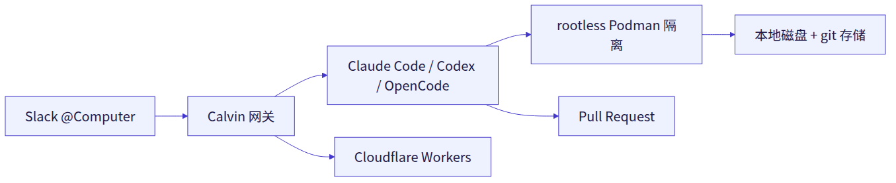
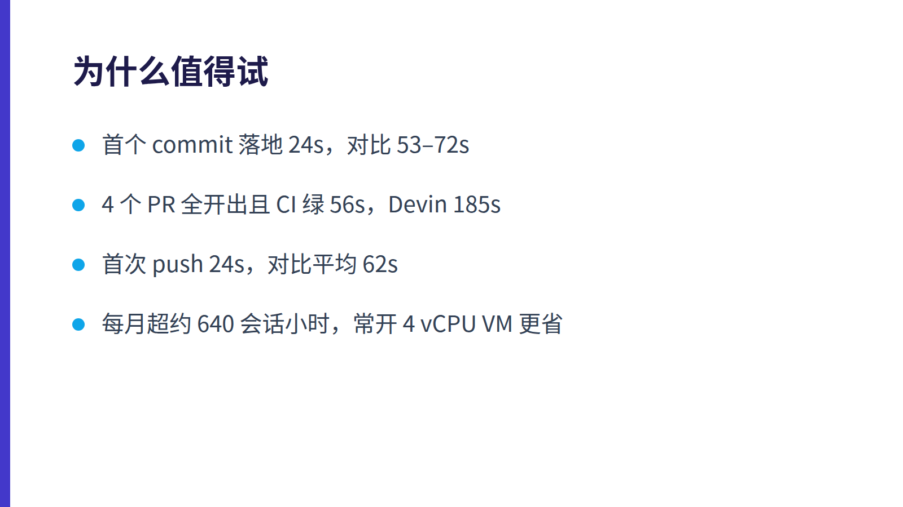

- 来源：Hacker News Show HN
- 项目链接：https://github.com/diggerhq/opencomputer
- HN 讨论：https://news.ycombinator.com/item?id=50581403（131 points）

---

# OpenComputer：可自托管的开源云端编码 Agent

> 一个开源的云端编码 Agent，团队在 Slack 里 @Computer 派任务，它在自己的「电脑」上干活，结果以 PR 形式交付；可跑在 OpenComputer Cloud，也可整套自托管到你自己的 AWS / GCP / Azure 账号。适合想把「云端编码 Agent」纳入团队流程、又在意数据与成本可控的团队。

## 它是什么

OpenComputer 由 diggerhq 开源（Apache-2.0），自我定位是 **Devin 的开源替代品**。核心交互不是本地 IDE 插件，而是 **Slack**：在会话里 @Computer 描述任务，它在一台独立虚拟机上执行，你和团队可以围观、随时纠偏，最终产出 Pull Request。

架构上它刻意做得「简单可自托管」：

- **整套栈跑在单台 VM 上**，官方建议把网络限制为仅出站访问。
- VM 上跑一个叫 **Calvin** 的网关，监听 Slack 事件，按配置拉起 **Claude Code、Codex 或 OpenCode** 会话。
- 每个会话用 **rootless Podman** 隔离；状态先写本地磁盘，再持久化到 git 支撑的存储。
- 其余部分跑在 **Cloudflare Workers / Durable Objects** 上，Fly 等平台的支持「即将推出」。

作者在自帖里补充了两个设计取舍：

- **一队一 VM、可水平扩展**，会话隔离在 git worktree 里；
- **每轮对话后把会话文件备份到仓库**，因此任何会话都能换一台 VM 续跑。

<!-- asset:blog-1 start -->


*图：OpenComputer 核心架构*
<!-- asset:blog-1 end -->


## 为什么值得试

官方给出的卖点集中在「快」和「省」：

| 指标 | OpenComputer | 对比对象 |
|---|---|---|
| 首个 commit 落地 | 24s | 其基准测试的替代方案 53–72s |
| 4 个 PR 全部开出且 CI 绿 | 56s | Devin 185s（官方称快 3.3x） |
| 首次 push | 24s | 4 个最流行云端 Agent 平均 62s（官方称快 2.6x） |

成本逻辑也讲得很直白：作者观察到**每月超过约 640 会话小时后，一台常开的 4 vCPU VM 比按会话计费的 E2B 沙箱更便宜**，所以规模化时它不只是更快，也更省。

作者在评论里解释了「又快又便宜」的关键实现：做了**两层隔离**——外层是带快速 NVMe 磁盘的 VM，VM 内再套更轻的 rootless Podman 沙箱；每个组织分到 N 台专属 VM（N≥1），VM 充当「软性并发上限」，同时保证会话隔离、固定落在你的 VM 上、启动快。

<!-- asset:blog-2 start -->


*图：官方卖点：快与省*
<!-- asset:blog-2 end -->


## 社区怎么评价

这条 Show HN 拿到 131 points，讨论量不大，但气氛友善，主要围绕**名字**：

- 有人直言「换个名字吧，现在这个名字说明不了什么，而且已经被占用了」，但补了一句「我还是会去试试」。
- 有人猜撞名的是 Minecraft 的模组 **OpenComputers**。
- 也有人替它说话：「有点狠，但至少比 Devin 强多了」；随后作者回应「Devin 是个好名字，我们很尊重他们做的东西」，并表示会认真考虑改名。
- 还有人对「开源还能这么便宜这么快」表示好奇，作者以上面的两层隔离方案作答。

整体看：**没有看到针对功能本身的负面反馈**，讨论集中在命名，产品体验层面的公开评价暂无更多资料。

## 对 Java / Spring 程序员 + Windows 上 Trae Work 的价值判断

先说结论：**它和你日常在 Trae Work 里写 Java 的体验基本是两条线，但值得作为「团队级异步编码」的补充去评估。**

- **不是 IDE 插件，也不是本地 CLI**：入口是 Slack，产出是 PR。它不会嵌进你在 Windows 上的 Trae Work 编辑器里补全代码，也不替代你本地的编码 Agent。
- **对 Java 后端团队的实际用途**：把「改配置、升依赖、批量修 lint、补测试、跑一遍 CI 再开 PR」这类边界清晰、可交给 CI 验证的任务丢给云端 Agent，人只做 review。Spring 项目如果 CI 完备，这类任务的收益会比较明显。
- **自托管是加分项**：代码与执行环境可以留在自己的云账号里，对合规敏感的团队比纯 SaaS 更容易过审。
- **需要留意的点**：底层驱动的是 Claude Code / Codex / OpenCode，官方支持自带 ChatGPT / Codex 订阅；Windows 本地开发环境本身不在这套体系里，你仍然在 Trae Work 里写主要业务代码。
- **与 AI 辅助软件开发的相关性**：相关，但它属于「云端 Agent 运行壳 / 控制中枢」这一类，而不是技能包或 IDE 插件。

## 怎么开始试用

1. **最快路径（云端）**：打开 `app.opencomputer.dev` 注册，连接仓库，安装 Slack 应用，然后在 Slack 线程里 @Computer 派任务。官方给出 **3 天免费试用、600 工作分钟**。
2. **自托管**：仓库提供自托管说明，整套栈可跑在自己的云账号（AWS / GCP / Azure）；官方建议把 VM 网络限制为仅出站。
3. **自带模型订阅**：支持接入你自己的 ChatGPT / Codex 订阅。
4. **先读架构文档**再决定是否自托管，重点看单 VM + Calvin 网关 + Podman 隔离这套结构是否符合你们的运维习惯。
5. **评估建议**：挑一个 Spring 项目里「CI 能兜底」的小任务（比如升级某个依赖并修好编译与测试），对比它开出的 PR 质量与你本地用 Trae Work 的产出，再判断是否值得推广到团队。

> 提醒：项目较新（仓库 1.8k stars、225 forks、13 个 open issues），命名可能变更，Fly 等平台支持官方称「即将推出」，其余细节以官方文档为准；未在公开资料中说明的部分，本文不作推断。

```text
背景：我在 Windows 上用 Trae Work 做 Java/Spring 后端开发，团队想评估「云端编码 Agent」是否能接管一部分边界清晰、CI 可验证的任务（如升级依赖、批量修 lint、补单测、修 CI 失败）。候选是开源项目 OpenComputer（自称 Devin 的开源替代，Slack 里 @Computer 派活，产出 PR，可自托管到 AWS/GCP/Azure，底层驱动 Claude Code / Codex / OpenCode）。

目标：帮我产出一份可执行的试用评估方案，判断它是否值得在我们团队落地。

要求：
1. 先梳理它的架构要点（单 VM + Calvin 网关 + rootless Podman 隔离 + git 支撑的会话持久化），指出自托管时我需要关注的运维与安全事项（官方建议 VM 仅出站网络）。
2. 给出 3 个适合首个试点的 Spring 项目任务，按「收益/风险」排序，并说明每个任务的验收标准（以 CI 绿灯 + PR 可 review 为准）。
3. 设计一个对比实验：同一任务分别由 OpenComputer 与我在 Trae Work 本地完成，记录耗时、PR 质量、返工次数，给出记录表格模板。
4. 列出接入前需要确认的清单（Slack 应用权限、仓库连接范围、模型订阅方式、免费试用 3 天/600 分钟的额度如何分配）。
5. 明确指出哪些信息官方未公开、需要我去文档或社区确认，不要替我编造。
```

---

> 本文由 AI 综合Show HN 原帖与社区讨论撰写，已要求其仅依据公开资料成文；关键命令请以官方文档为准。
